# 岳阳市美术馆预约平台（小程序--论文pf

> 🎓 **计算机毕业设计 · 岳阳市美术馆预约平台（小程序--论文pf**
>
> 本仓库只放**项目介绍 + 运行截图**（截图是站点带水印的原图，存在仓库 `images/` 里）。
>
> 👉 **完整可运行源码 / 数据库脚本 / 部署文档：[点我获取](https://geekcode.top/archives/%E5%B2%B3%E9%98%B3%E5%B8%82%E7%BE%8E%E6%9C%AF%E9%A6%86%E9%A2%84%E7%BA%A6%E5%B9%B3%E5%8F%B0%EF%BC%88%E5%B0%8F%E7%A8%8B%E5%BA%8F-%E8%AE%BA%E6%96%87pf?utm_source=github)**
>
> 💬 咨询微信：**ir9372**　|　🌐 更多项目：[极客代码 geekcode.top](https://geekcode.top/?utm_source=github)
>
> 📌 项目详情页：<https://geekcode.top/archives/%E5%B2%B3%E9%98%B3%E5%B8%82%E7%BE%8E%E6%9C%AF%E9%A6%86%E9%A2%84%E7%BA%A6%E5%B9%B3%E5%8F%B0%EF%BC%88%E5%B0%8F%E7%A8%8B%E5%BA%8F-%E8%AE%BA%E6%96%87pf?utm_source=github>

<table><td width="230" align="center"> <b>扫码加微信 ir9372</b></td><td valign="middle">📦 源码 = 项目介绍 + 全部运行截图 + 数据库 + 部署文档 👉 点上方任意截图，直接跳到 <b>极客代码 geekcode.top</b> 详情页</td></table>

---

<h1>岳阳市美术馆预约平台（小程序--论文pf</h1>
<h2>项目概述</h2>

本项目名为“岳阳市美术馆预约平台”，旨在构建一个集线上参观预约、展品信息展示、互动交流及后台管理于一体的综合性数字化服务平台。系统采用前后端分离架构，前端主要面向普通用户，通过微信小程序提供便捷的移动端服务入口；后端基于 Java 技术栈构建，负责业务逻辑处理、数据持久化及权限控制。核心功能涵盖美术馆与展品的浏览、在线预约参观、收藏留言、公告通知查看以及用户账户管理等。该平台的适用人群包括计划前往岳阳市美术馆参观的公众用户以及负责内容维护与运营的管理员。通过技术手段优化传统线下预约流程，提升用户体验与管理效率。

<h2>技术架构</h2>

本项目采用典型的前后端分离开发模式，确保系统的可扩展性与维护性。

<strong>1. 后端架构</strong>
后端基于 Spring Boot 框架搭建，利用其自动配置特性简化开发流程。数据持久层选用 MyBatis-Plus，在 MyBatis 的基础上提供了更高效的 CRUD 操作能力，并支持代码生成器快速构建基础模型。安全认证与授权模块集成 Apache Shiro，用于管理后台管理员登录状态及接口访问权限。视图层虽引入了 Thymeleaf，但根据路由配置，主要服务于后台管理界面的渲染或特定模板需求，而小程序端则完全依赖 RESTful API 进行交互。数据库选用 MySQL，存储用户信息、美术馆数据、预约记录等核心业务数据。

<strong>2. 前端架构（微信小程序）</strong>
前端采用微信小程序原生开发或基于 Vue 生态的小程序框架（如 uni-app/mpvue，鉴于项目类型为 vue-integrated）。小程序端通过 HTTP 请求调用后端提供的 REST API 接口获取数据。界面设计遵循微信官方规范，包含首页、个人中心、预约列表等多个页面。

<strong>3. 交互方式</strong>
小程序前端与 Java 后端之间通过标准的 JSON 格式数据进行通信。后端 Controller 层暴露 <code>/api</code> 或类似前缀的接口，处理来自小程序的请求（如查询展品、提交预约、用户注册登录等），并返回统一格式的响应结果。

<a href="https://geekcode.top/archives/%E5%B2%B3%E9%98%B3%E5%B8%82%E7%BE%8E%E6%9C%AF%E9%A6%86%E9%A2%84%E7%BA%A6%E5%B9%B3%E5%8F%B0%EF%BC%88%E5%B0%8F%E7%A8%8B%E5%BA%8F-%E8%AE%BA%E6%96%87pf?utm_source=github" title="查看完整源码">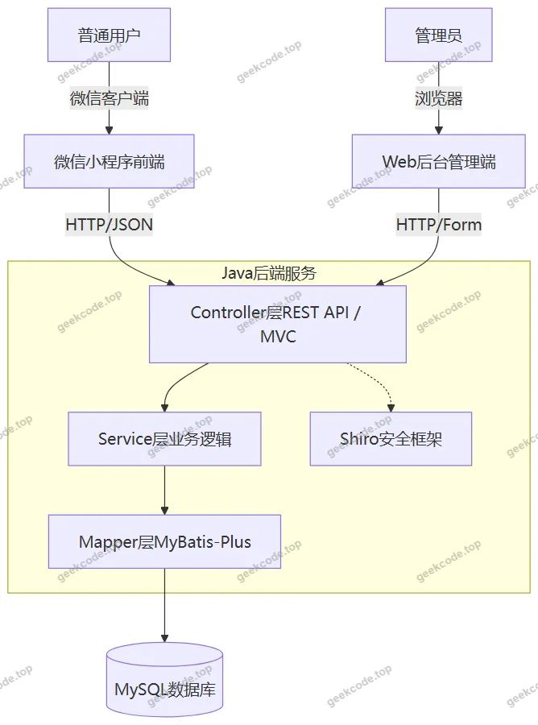</a>

<h2>功能模块</h2>

根据源码中的 Controller 列表、后台路由及小程序截图功能，系统将分为小程序用户端和 Web 后台管理端两大模块。

<h3>1. 小程序用户端功能</h3>

小程序面向普通注册用户，提供以下核心功能：

<ul>
<li><strong>用户体系</strong>：</li>
<li><strong>登录/注册</strong>：支持新用户注册及现有用户登录。</li>
<li><strong>密码管理</strong>：包含忘记密码找回及修改密码功能。</li>
<li><strong>个人信息</strong>：查看和编辑个人资料（userinfo），支持账户充值功能。</li>
<li><strong>资讯与展览</strong>：</li>
<li><strong>首页展示</strong>：轮播图、推荐内容及快捷入口。</li>
<li><strong>公告通知</strong>：查看美术馆发布的最新新闻和公告（News）。</li>
<li><strong>美术馆信息</strong>：浏览美术馆简介、开放时间等基本信息（Meishuguan）。</li>
<li><strong>展品信息</strong>：详细查看馆内展出物品的介绍（Zhanpin）。</li>
<li><strong>互动与收藏</strong>：</li>
<li><strong>收藏功能</strong>：用户可收藏感兴趣的美术馆或具体展品，并在“我的”页面查看收藏列表（MeishuguanCollection, ZhanpinCollection）。</li>
<li><strong>留言互动</strong>：针对美术馆或展品发表留言评论，并可查看自己的留言记录（MeishuguanLiuyan, ZhanpinLiuyan）。</li>
<li><strong>预约服务</strong>：</li>
<li><strong>参观预约</strong>：发起参观预约申请，填写相关信息。</li>
<li><strong>预约管理</strong>：查看个人历史预约记录及当前待处理的预约订单（MeishuguanOrder）。</li>
<li><strong>确认预约</strong>：对预约信息进行最终确认操作。</li>
</ul>
<h3>2. Web 后台管理端功能</h3>

后台管理系统面向管理员，提供全面的数据管理与配置功能：

<ul>
<li><strong>系统管理</strong>：</li>
<li><strong>登录页</strong>：管理员身份验证入口。</li>
<li><strong>配置文件</strong>：管理系统全局参数（Config）。</li>
<li><strong>字典管理</strong>：维护系统各类枚举值，如性别、论坛状态、美术馆类型、展品分类等（Dictionary 系列 Controller）。</li>
<li><strong>操作日志</strong>：记录关键业务操作轨迹，便于审计（Caozuorizhi）。</li>
<li><strong>备份还原</strong>：提供数据库备份与还原功能（Beifen, Huanyuan）。</li>
<li><strong>用户管理</strong>：</li>
<li><strong>管理员管理</strong>：维护后台管理员账号（Users）。</li>
<li><strong>注册用户管理</strong>：查看和管理小程序端的注册用户信息（Yonghu）。</li>
<li><strong>业务内容管理</strong>：</li>
<li><strong>美术馆管理</strong>：增删改查美术馆基本信息（Meishuguan）。</li>
<li><strong>展品管理</strong>：维护展品详细信息（Zhanpin）。</li>
<li><strong>公告新闻管理</strong>：发布和管理前台显示的新闻公告（News）。</li>
<li><strong>论坛/社区管理</strong>：若涉及社区功能，管理相关帖子或讨论区（Forum）。</li>
<li><strong>互动数据管理</strong>：</li>
<li><strong>预约订单管理</strong>：审核、查询用户的参观预约记录（MeishuguanOrder）。</li>
<li><strong>留言管理</strong>：查看和处理用户对美术馆及展品的留言（MeishuguanLiuyan, ZhanpinLiuyan）。</li>
<li><strong>收藏数据监控</strong>：查看用户的收藏行为数据（MeishuguanCollection, ZhanpinCollection）。</li>
</ul>
<h2>用户角色与权限</h2>

本系统主要涉及两类用户角色，分别对应不同的访问终端和功能权限范围。

<h3>1. 普通用户（小程序端）</h3>
<ul>
<li><strong>定义</strong>：通过微信小程序注册并登录的个人访客。</li>
<li><strong>权限范围</strong>：</li>
<li><strong>只读权限</strong>：浏览首页、公告、美术馆详情、展品详情。</li>
<li><strong>写入权限</strong>：注册账号、修改个人信息、重置密码、账户充值。</li>
<li><strong>交互权限</strong>：创建参观预约订单、收藏/取消收藏美术馆或展品、发表留言/评论。</li>
<li><strong>数据隔离</strong>：仅能查看和操作属于自己的预约记录、收藏列表及留言内容。</li>
</ul>
<h3>2. 管理员（Web 后台端）</h3>
<ul>
<li><strong>定义</strong>：负责平台运营与维护的工作人员，拥有最高系统权限。</li>
<li><strong>权限范围</strong>：</li>
<li><strong>全量数据管理</strong>：对所有用户（包括其他管理员）、美术馆、展品、新闻、预约订单、留言、收藏记录进行增删改查。</li>
<li><strong>系统配置</strong>：修改系统参数、维护数据字典、执行数据备份与还原。</li>
<li><strong>审计与安全</strong>：查看操作日志，监控系统运行状态。</li>
<li><strong>审核职能</strong>：虽然源码未明确体现复杂的审批流，但管理员通常具备对用户提交的预约或敏感留言进行处理（如删除违规内容）的能力。</li>
</ul>
<h2>项目特色与创新点</h2>
<ol>
<li><strong>移动端优先的服务体验</strong>：依托微信小程序无需安装、即用即走的特性，降低了用户使用门槛。结合 LBS（基于位置的服务）潜在能力，方便游客快速完成从信息查询到预约的全流程操作。</li>
<li><strong>完善的闭环业务逻辑</strong>：不仅实现了基础的展示功能，还构建了“浏览-收藏-留言-预约-订单管理”的完整业务闭环。特别是将“预约”作为核心场景，解决了传统美术馆排队购票或登记繁琐的问题。</li>
<li><strong>灵活的数据字典驱动机制</strong>：后端大量使用 Dictionary 相关的 Controller 和路由（如 <code>dictionaryMeishuguan</code>, <code>dictionaryZhanpin</code> 等），表明系统采用了数据字典来动态管理分类、状态等业务属性。这种设计使得在不修改代码的情况下，管理员即可调整业务规则或新增分类标签，提升了系统的可维护性和扩展性。</li>
<li><strong>安全性与可追溯性</strong>：集成 Shiro 框架保障接口安全，同时引入“操作日志”和“备份还原”模块，增强了系统在数据安全和灾难恢复方面的能力，符合企业级应用的标准。</li>
</ol>
<h2>部署环境</h2>

为确保项目正常运行，需准备以下软硬件环境：

<strong>1. 软件环境</strong>

<ul>
<li><strong>操作系统</strong>：Windows 10/11 或 Linux (CentOS/Ubuntu)。</li>
<li><strong>JDK</strong>：Java Development Kit 1.8 或更高版本（Spring Boot 兼容版本）。</li>
<li><strong>数据库</strong>：MySQL 5.7 或 MySQL 8.0。需初始化相应的数据库表结构。</li>
<li><strong>构建工具</strong>：Maven 3.6+ 用于后端依赖管理和打包。</li>
<li><strong>Node.js</strong>：建议 v12 或 v14+，用于编译前端资源（若使用 npm/yarn 管理小程序依赖）。</li>
<li><strong>IDE</strong>：IntelliJ IDEA (后端), VS Code 或 HBuilderX (前端/小程序)。</li>
<li><strong>调试工具</strong>：微信开发者工具（WeChat DevTools），用于小程序的代码编写、预览和真机调试。</li>
</ul>

<strong>2. 硬件环境</strong>

<ul>
<li><strong>CPU</strong>：双核及以上处理器。</li>
<li><strong>内存</strong>：建议 4GB 以上（开发阶段），生产环境视并发量而定。</li>
<li><strong>硬盘</strong>：至少 10GB 可用空间。</li>
</ul>

<strong>3. 网络环境</strong>

<ul>
<li>后端服务器需开放相应端口（默认为 8080 或其他配置端口）。</li>
<li>小程序端需在微信公众平台配置合法的域名白名单（request 合法域名），以便能够成功调用后端 API。</li>
</ul>
<h2>五、技术特性</h2>
<ul>
<li>前后端集成部署，前端资源打包至后端 static 目录</li>
<li>使用 MyBatis-Plus 简化数据访问层开发</li>
<li>集成 Shiro 权限框架实现角色权限控制</li>
</ul>
<h2>六、功能模块截图</h2>
<h3>微信小程序用户端</h3>

<figure><figcaption>小程序-参观预约列表</figcaption></figure>
<figure><figcaption>小程序-参观预约confirm</figcaption></figure>
<figure><a href="https://geekcode.top/archives/%E5%B2%B3%E9%98%B3%E5%B8%82%E7%BE%8E%E6%9C%AF%E9%A6%86%E9%A2%84%E7%BA%A6%E5%B9%B3%E5%8F%B0%EF%BC%88%E5%B0%8F%E7%A8%8B%E5%BA%8F-%E8%AE%BA%E6%96%87pf?utm_source=github" title="查看完整源码">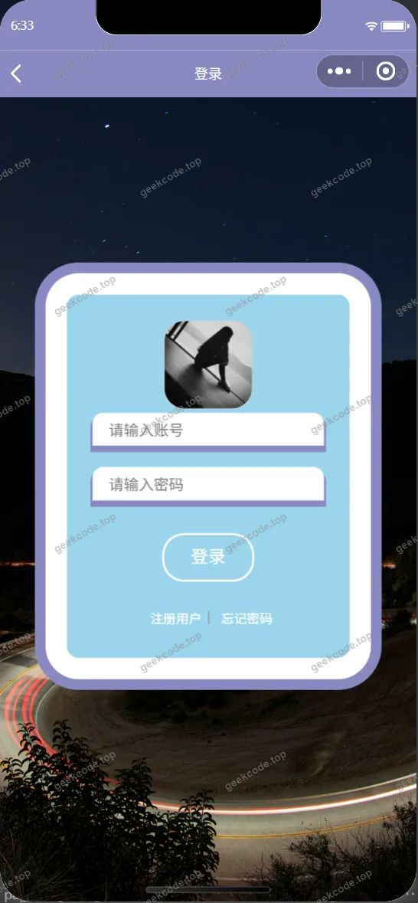</a><figcaption>小程序-登录</figcaption></figure>
<figure><figcaption>小程序-个人信息userinfo</figcaption></figure>
<figure><figcaption>小程序-公告通知列表</figcaption></figure>
<figure><a href="https://geekcode.top/archives/%E5%B2%B3%E9%98%B3%E5%B8%82%E7%BE%8E%E6%9C%AF%E9%A6%86%E9%A2%84%E7%BA%A6%E5%B9%B3%E5%8F%B0%EF%BC%88%E5%B0%8F%E7%A8%8B%E5%BA%8F-%E8%AE%BA%E6%96%87pf?utm_source=github" title="查看完整源码">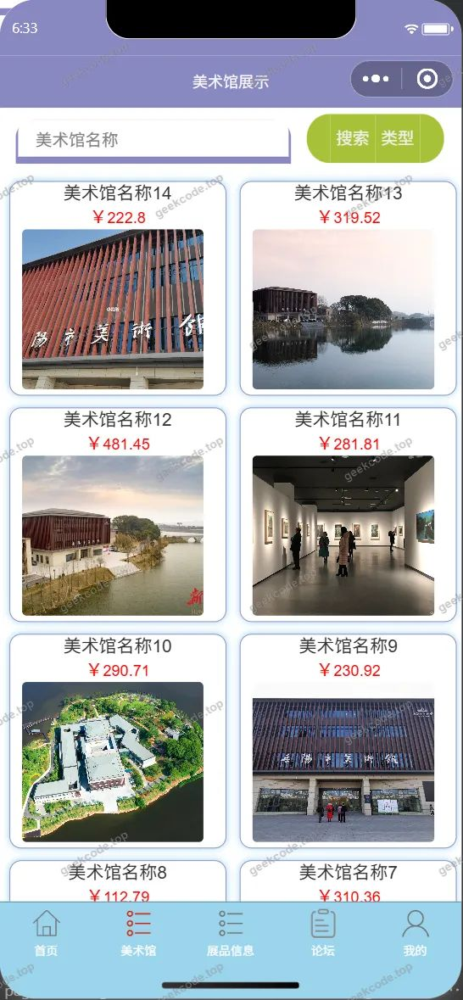</a><figcaption>小程序-美术馆</figcaption></figure>
<figure><figcaption>小程序-美术馆留言列表</figcaption></figure>
<figure><a href="https://geekcode.top/archives/%E5%B2%B3%E9%98%B3%E5%B8%82%E7%BE%8E%E6%9C%AF%E9%A6%86%E9%A2%84%E7%BA%A6%E5%B9%B3%E5%8F%B0%EF%BC%88%E5%B0%8F%E7%A8%8B%E5%BA%8F-%E8%AE%BA%E6%96%87pf?utm_source=github" title="查看完整源码">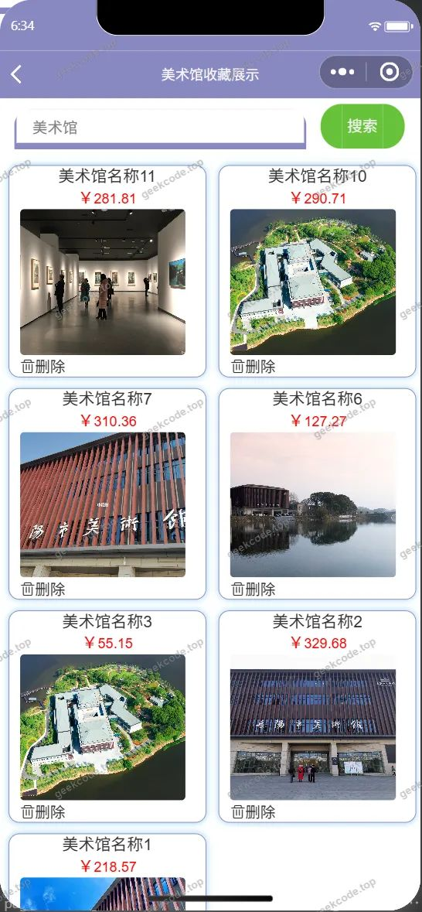</a><figcaption>小程序-美术馆收藏列表</figcaption></figure>
<figure><a href="https://geekcode.top/archives/%E5%B2%B3%E9%98%B3%E5%B8%82%E7%BE%8E%E6%9C%AF%E9%A6%86%E9%A2%84%E7%BA%A6%E5%B9%B3%E5%8F%B0%EF%BC%88%E5%B0%8F%E7%A8%8B%E5%BA%8F-%E8%AE%BA%E6%96%87pf?utm_source=github" title="查看完整源码">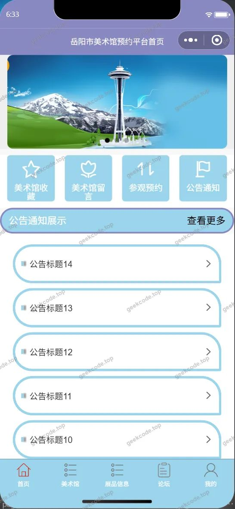</a><figcaption>小程序-首页</figcaption></figure>
<figure><figcaption>小程序-忘记密码</figcaption></figure>
<figure><a href="https://geekcode.top/archives/%E5%B2%B3%E9%98%B3%E5%B8%82%E7%BE%8E%E6%9C%AF%E9%A6%86%E9%A2%84%E7%BA%A6%E5%B9%B3%E5%8F%B0%EF%BC%88%E5%B0%8F%E7%A8%8B%E5%BA%8F-%E8%AE%BA%E6%96%87pf?utm_source=github" title="查看完整源码">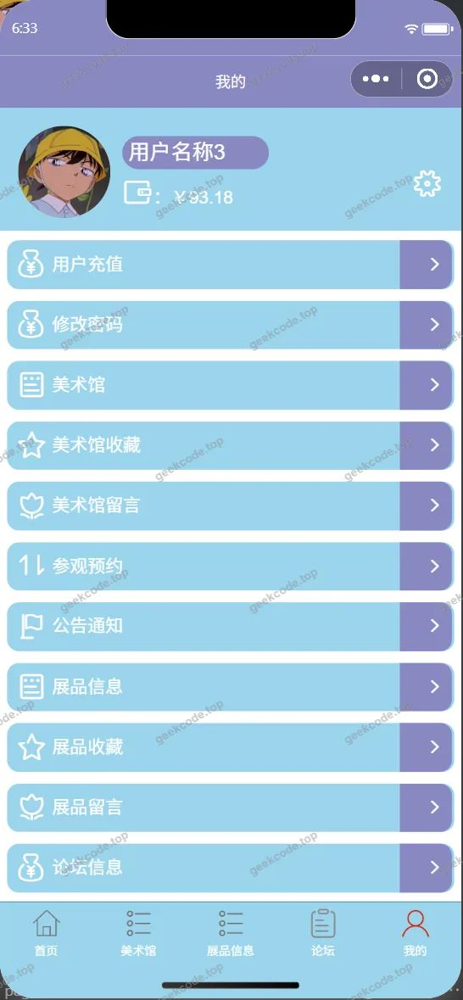</a><figcaption>小程序-我的</figcaption></figure>
<figure><figcaption>小程序-展品留言列表</figcaption></figure>
<figure><a href="https://geekcode.top/archives/%E5%B2%B3%E9%98%B3%E5%B8%82%E7%BE%8E%E6%9C%AF%E9%A6%86%E9%A2%84%E7%BA%A6%E5%B9%B3%E5%8F%B0%EF%BC%88%E5%B0%8F%E7%A8%8B%E5%BA%8F-%E8%AE%BA%E6%96%87pf?utm_source=github" title="查看完整源码">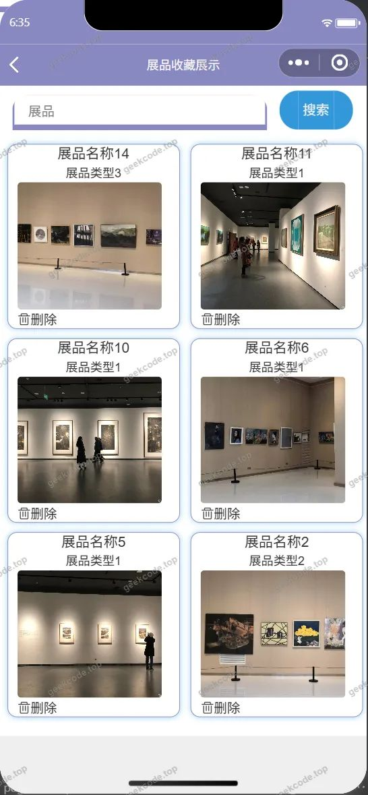</a><figcaption>小程序-展品收藏列表</figcaption></figure>
<figure><a href="https://geekcode.top/archives/%E5%B2%B3%E9%98%B3%E5%B8%82%E7%BE%8E%E6%9C%AF%E9%A6%86%E9%A2%84%E7%BA%A6%E5%B9%B3%E5%8F%B0%EF%BC%88%E5%B0%8F%E7%A8%8B%E5%BA%8F-%E8%AE%BA%E6%96%87pf?utm_source=github" title="查看完整源码">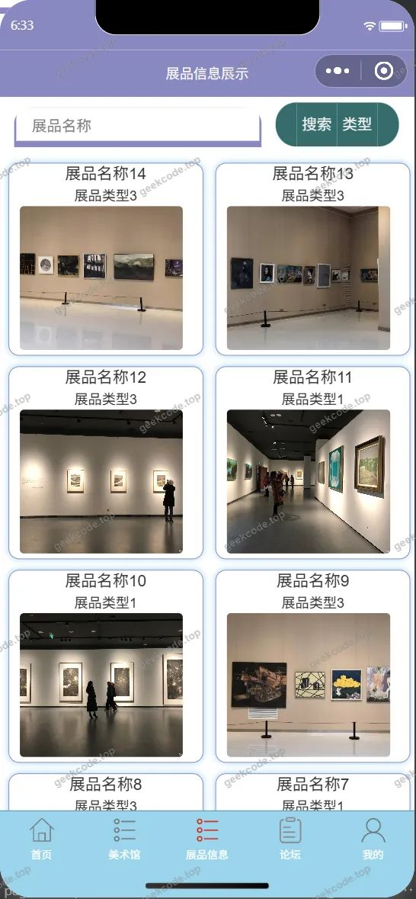</a><figcaption>小程序-展品信息</figcaption></figure>
<figure><a href="https://geekcode.top/archives/%E5%B2%B3%E9%98%B3%E5%B8%82%E7%BE%8E%E6%9C%AF%E9%A6%86%E9%A2%84%E7%BA%A6%E5%B9%B3%E5%8F%B0%EF%BC%88%E5%B0%8F%E7%A8%8B%E5%BA%8F-%E8%AE%BA%E6%96%87pf?utm_source=github" title="查看完整源码">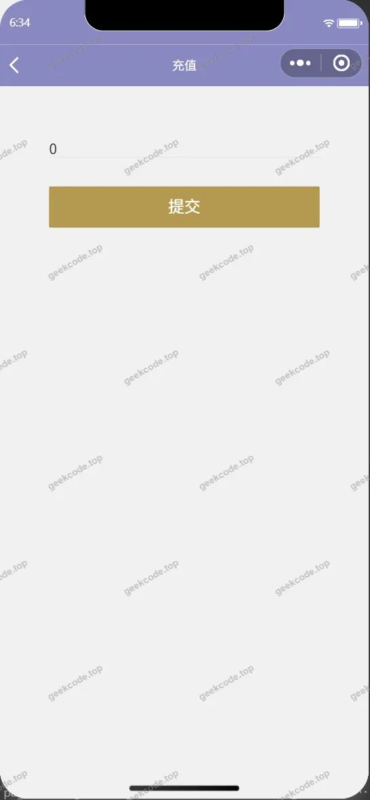</a><figcaption>小程序-账户充值</figcaption></figure>
<figure><a href="https://geekcode.top/archives/%E5%B2%B3%E9%98%B3%E5%B8%82%E7%BE%8E%E6%9C%AF%E9%A6%86%E9%A2%84%E7%BA%A6%E5%B9%B3%E5%8F%B0%EF%BC%88%E5%B0%8F%E7%A8%8B%E5%BA%8F-%E8%AE%BA%E6%96%87pf?utm_source=github" title="查看完整源码">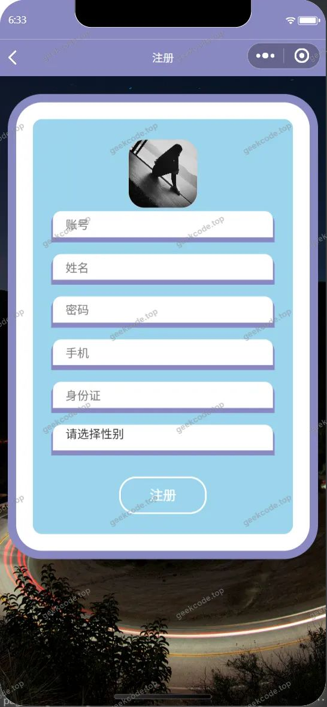</a><figcaption>小程序-注册</figcaption></figure>
<figure><figcaption>小程序-changepassword</figcaption></figure>

<h3>后台管理端</h3>
<h4>后台-操作日志</h4>

<a href="https://geekcode.top/archives/%E5%B2%B3%E9%98%B3%E5%B8%82%E7%BE%8E%E6%9C%AF%E9%A6%86%E9%A2%84%E7%BA%A6%E5%B9%B3%E5%8F%B0%EF%BC%88%E5%B0%8F%E7%A8%8B%E5%BA%8F-%E8%AE%BA%E6%96%87pf?utm_source=github" title="查看完整源码">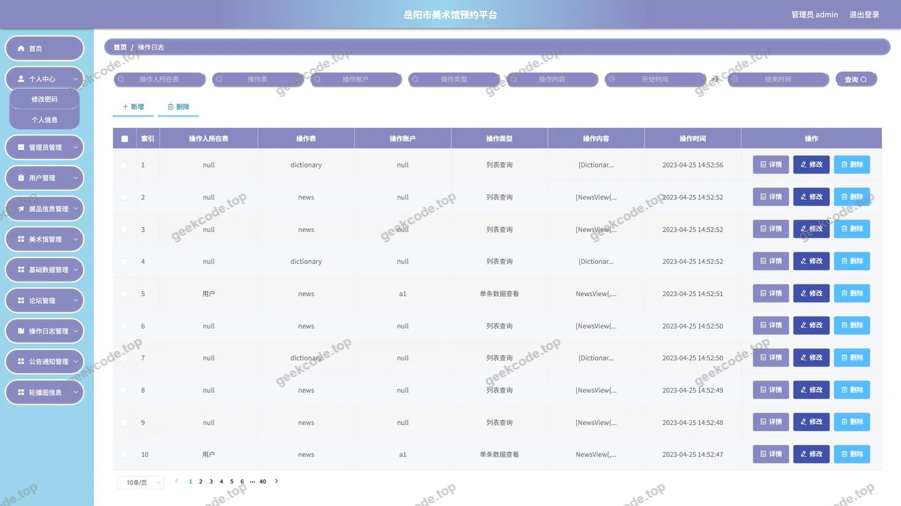</a>

<h4>后台-登录页</h4>

<h4>后台-公告通知</h4>

<a href="https://geekcode.top/archives/%E5%B2%B3%E9%98%B3%E5%B8%82%E7%BE%8E%E6%9C%AF%E9%A6%86%E9%A2%84%E7%BA%A6%E5%B9%B3%E5%8F%B0%EF%BC%88%E5%B0%8F%E7%A8%8B%E5%BA%8F-%E8%AE%BA%E6%96%87pf?utm_source=github" title="查看完整源码">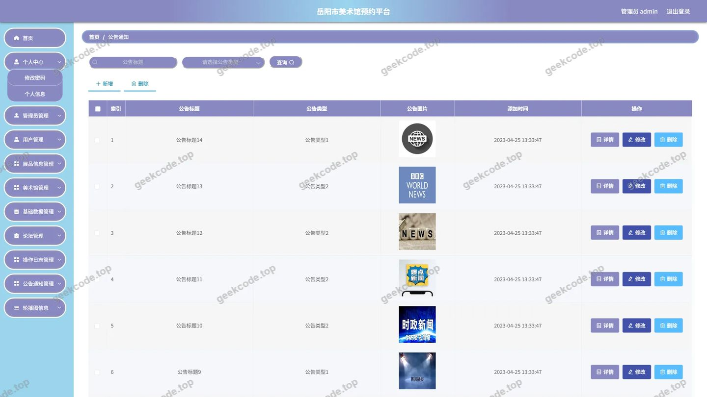</a>

<h4>后台-管理员</h4>

<a href="https://geekcode.top/archives/%E5%B2%B3%E9%98%B3%E5%B8%82%E7%BE%8E%E6%9C%AF%E9%A6%86%E9%A2%84%E7%BA%A6%E5%B9%B3%E5%8F%B0%EF%BC%88%E5%B0%8F%E7%A8%8B%E5%BA%8F-%E8%AE%BA%E6%96%87pf?utm_source=github" title="查看完整源码">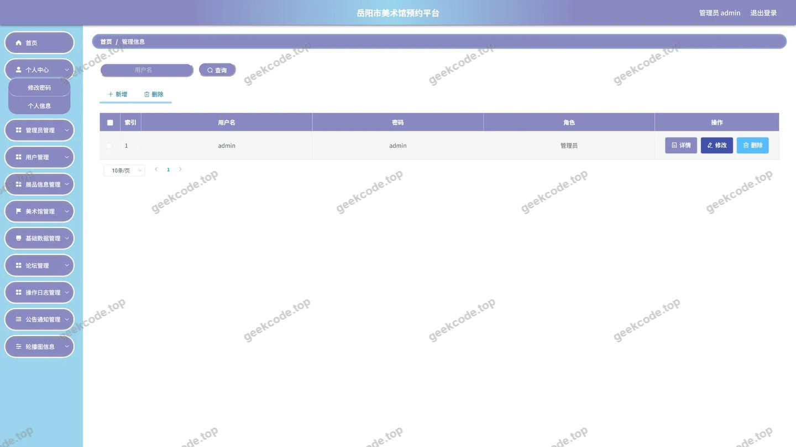</a>

<h4>后台-美术馆</h4>

<a href="https://geekcode.top/archives/%E5%B2%B3%E9%98%B3%E5%B8%82%E7%BE%8E%E6%9C%AF%E9%A6%86%E9%A2%84%E7%BA%A6%E5%B9%B3%E5%8F%B0%EF%BC%88%E5%B0%8F%E7%A8%8B%E5%BA%8F-%E8%AE%BA%E6%96%87pf?utm_source=github" title="查看完整源码">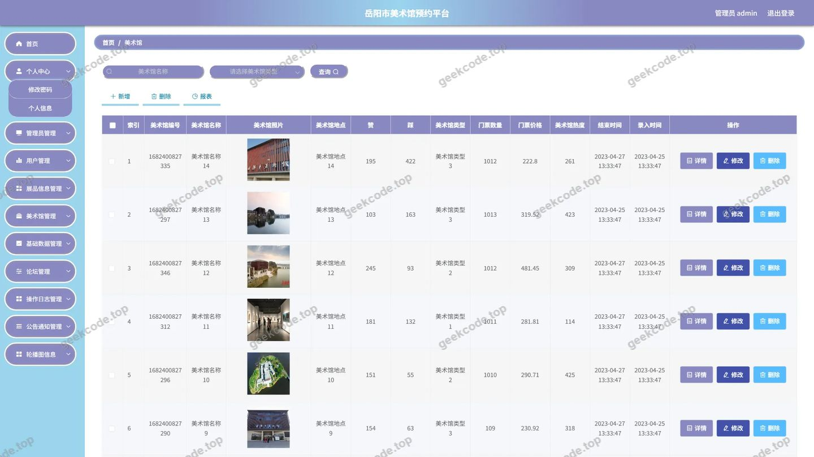</a>

<h4>后台-配置文件</h4>

<a href="https://geekcode.top/archives/%E5%B2%B3%E9%98%B3%E5%B8%82%E7%BE%8E%E6%9C%AF%E9%A6%86%E9%A2%84%E7%BA%A6%E5%B9%B3%E5%8F%B0%EF%BC%88%E5%B0%8F%E7%A8%8B%E5%BA%8F-%E8%AE%BA%E6%96%87pf?utm_source=github" title="查看完整源码">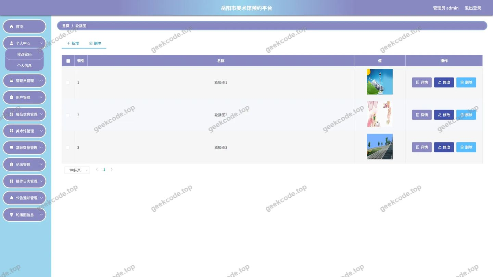</a>

<h4>后台首页</h4>

<a href="https://geekcode.top/archives/%E5%B2%B3%E9%98%B3%E5%B8%82%E7%BE%8E%E6%9C%AF%E9%A6%86%E9%A2%84%E7%BA%A6%E5%B9%B3%E5%8F%B0%EF%BC%88%E5%B0%8F%E7%A8%8B%E5%BA%8F-%E8%AE%BA%E6%96%87pf?utm_source=github" title="查看完整源码">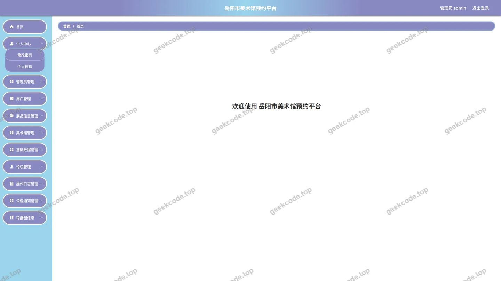</a>

<h4>后台-用户</h4>

<a href="https://geekcode.top/archives/%E5%B2%B3%E9%98%B3%E5%B8%82%E7%BE%8E%E6%9C%AF%E9%A6%86%E9%A2%84%E7%BA%A6%E5%B9%B3%E5%8F%B0%EF%BC%88%E5%B0%8F%E7%A8%8B%E5%BA%8F-%E8%AE%BA%E6%96%87pf?utm_source=github" title="查看完整源码">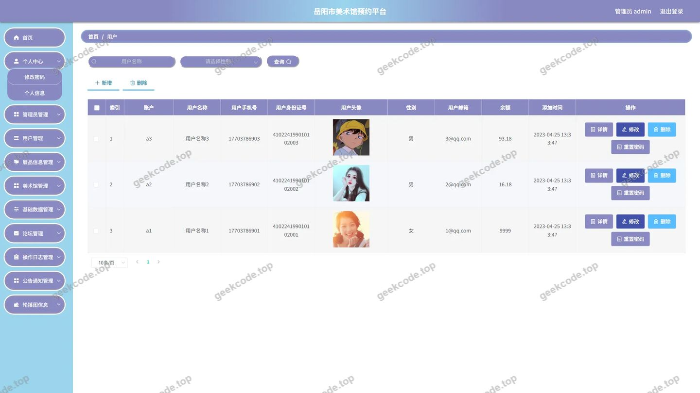</a>

---

## 获取完整源码

| 项目 | 说明 |
| --- | --- |
| 项目名 | 岳阳市美术馆预约平台（小程序--论文pf |
| 运行截图 | 本文 26 张（站点带水印原图，仓库 `images/` 目录） |
| 完整源码 | [https://geekcode.top/archives/%E5%B2%B3%E9%98%B3%E5%B8%82%E7%BE%8E%E6%9C%AF%E9%A6%86%E9%A2%84%E7%BA%A6%E5%B9%B3%E5%8F%B0%EF%BC%88%E5%B0%8F%E7%A8%8B%E5%BA%8F-%E8%AE%BA%E6%96%87pf?utm_source=github](https://geekcode.top/archives/%E5%B2%B3%E9%98%B3%E5%B8%82%E7%BE%8E%E6%9C%AF%E9%A6%86%E9%A2%84%E7%BA%A6%E5%B9%B3%E5%8F%B0%EF%BC%88%E5%B0%8F%E7%A8%8B%E5%BA%8F-%E8%AE%BA%E6%96%87pf?utm_source=github) |
| 咨询微信 | **ir9372**（备注：jingpin-yuanma） |
| 更多项目 | [极客代码 geekcode.top](https://geekcode.top/?utm_source=github) |

> 需要源码、部署、改配置、跑不起来等问题，加微信 ir9372 沟通，说明项目名即可。
